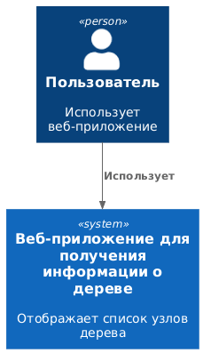
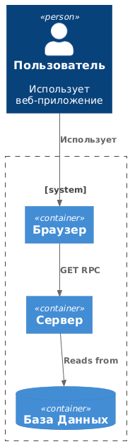
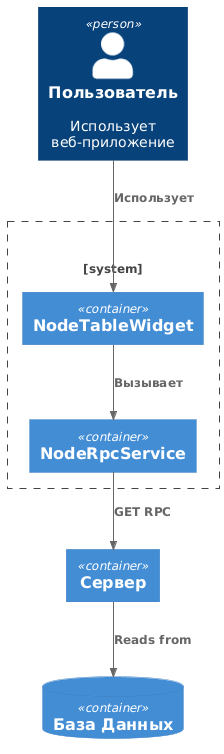
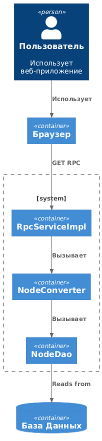
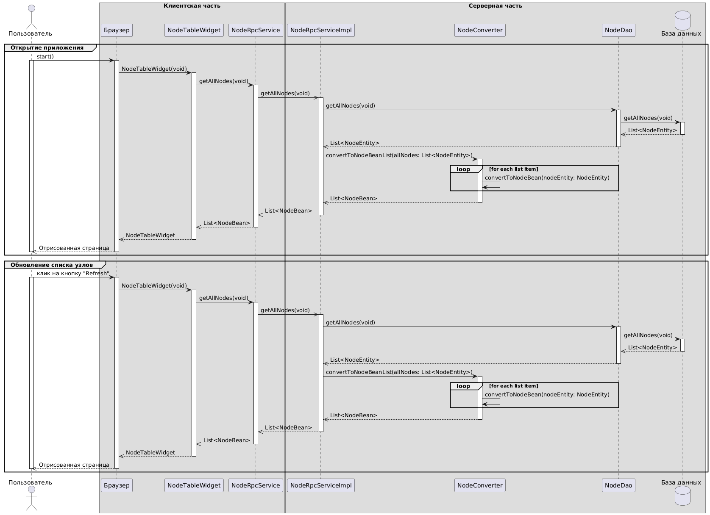
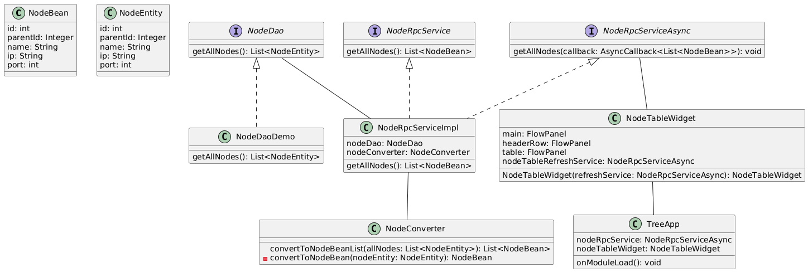

# Проектирование: Дерево

## Потребители

Пользователь

## Use Case

- **Я как** Пользователь **хочу** просмотреть список с информацией о каждом узле дерева из хранилища **чтобы** проверять дерево с фактическими данными в базе 
- **Я как** Пользователь **хочу** обновить список с информацией об узлах дерева **чтобы** иметь актуальные данные о дереве

## Существительные и глаголы

### Существительные

- Узел
- Дерево
- Список
- Хранилище

### Глаголы

- Просмотреть
- Обновить

## Сущности и Сервисы

### Сущности

- NodeBean
- NodeEntity

### Сервисы

- Показатор (NodeTableWidget)
- Обновлятор (NodeTableRefreshService)
- Получатор Данных С Сервера (NodeRpcService)
- Отправлятор Данных (NodeRpcServiceImpl)
- Преобразоватор Данных (NodeConverter)
- Получатор Данных Из Базы Данных (NodeDao)

## Диаграмма C4

### Контекст

### Контейнеры

### Компонент (Клиентская часть)

### Компонент (Серверная часть)

## Диаграмма последовательности

## Диаграмма классов

